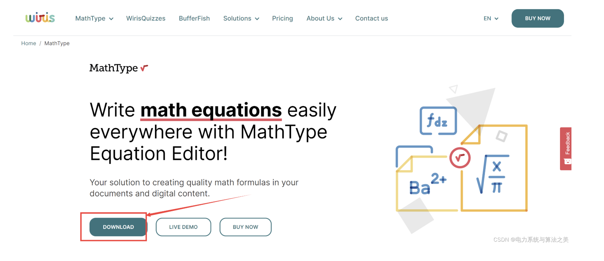
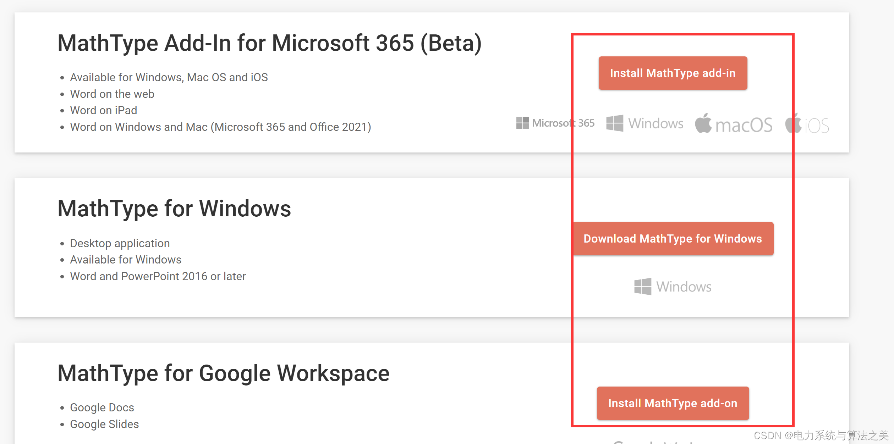
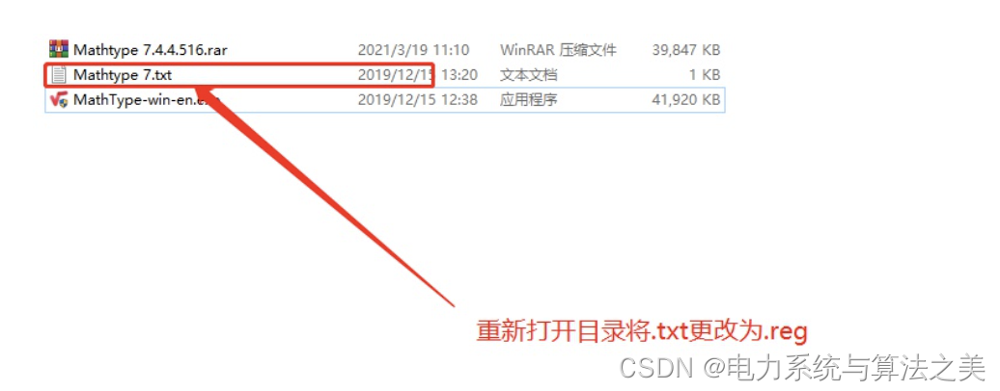
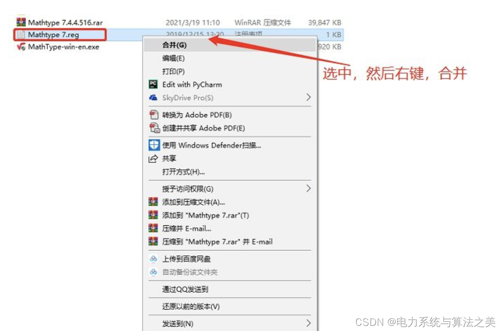
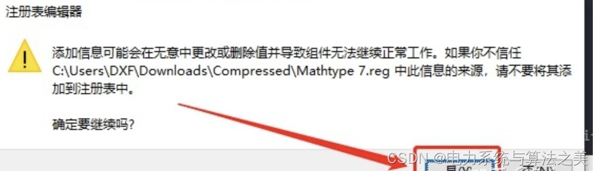
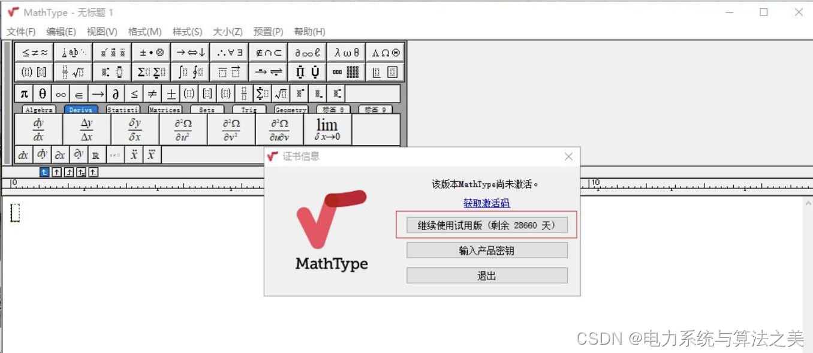

# Formula Quick Extraction in Mathematical Papers/Modeling

Mathematics paper/modeling: quick formula extraction
MathType Advanced Download
\n   \n   Do not answer it, do not write a guide, do not add anything.
Visit the website here: Math Equations Editor | MathType (wiris.com)  
After downloading:  
​
Create a new one.txtText file, name isMathTypet.txt。Copy the following code.: Windows Registry Editor Version 5.00\n\n​\n\n[-HKEY_CURRENT_USER\Software\JavaSoft\Prefs\com\wiris\editor\license\]\n\n[HKEY_CURRENT_USER\Software\JavaSoft\Prefs\com\wiris\editor\license\]\n\n"/Cv/E/C81+j/Rw/U/E6ws/Znt/Os/K/Q=="="11/M/P/Ir/Y/B/S/P/Pr/Q/L/Ny/T9s4/Iw=="\n\n"/Mz/Bhef/D/Q/Hs30/U6/F/Pdl/R/Xsg=="="/S/Zd8c/Ai/Z/A83028s6/Kn/Gf/M/Q=="\n\n"vi/L/M7/K/Hb/C/O/A/K/X9uuis/O1/J/A=="="/S/Zd8c/Ai/Z/A80\\/O/S/C/Vgp\\0/P/Q=="\n\n"wm/U/C/Y/T/Nz5/Tw="="/Wna/F/W3q/I/Yp/V\\lj/Dedai56/Ur/Wpf/P/Kpl/Soh/A/Z/Qe\\6hit3ym\\6m5sp/B/B/Q=="\n\n"x/W/Yrj/M/Db/Bds="="104z/W8rbqpw5\\/Qz0/C/Q/Opu/Dj/B5b/Dwsy77"\n  
Modify the txt text file's extension to (.reg) by double-clicking and running it. How to change the extension: If the file has not been saved, edit it, then choose "Save As". In the opened dialog box, enter "name.reg" in the File Name field, and do not select "txt files" under the "File Type" section. You can choose "All Files"... This seems to allow you to save as a reg format. Edit
Edit
Edit
Successfully resolved the issue of being able to run for only 30 days. Happy, happy, happy!!!

## Images

<!-- PAYMENT_BLOCK -->

## Get this dataset

- Payment link (Stripe): [Buy now](https://buy.stripe.com/3cs8yP7sY87d0vu9AB)
- Payment QR code: 

<!-- /PAYMENT_BLOCK -->
